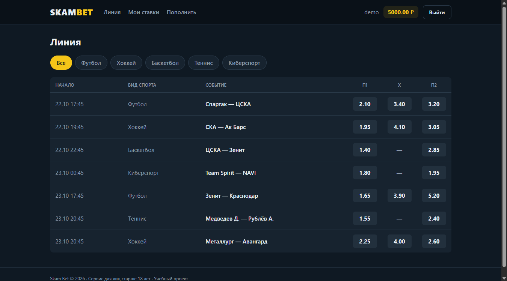
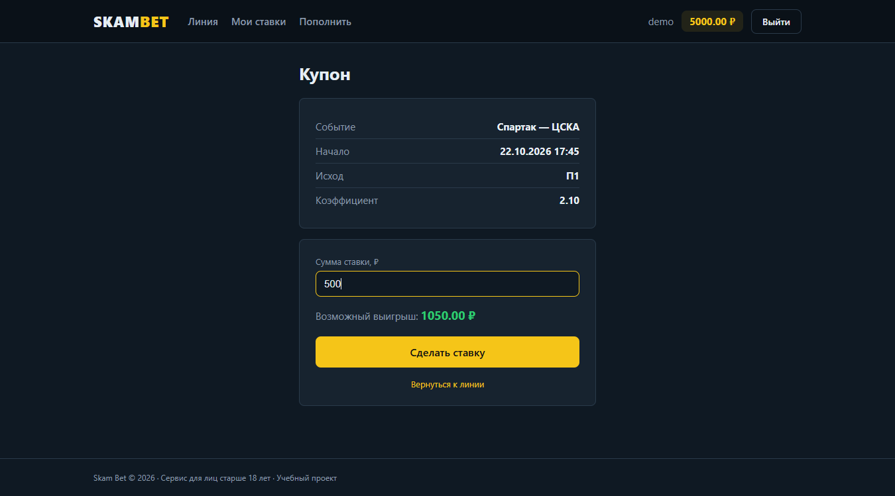
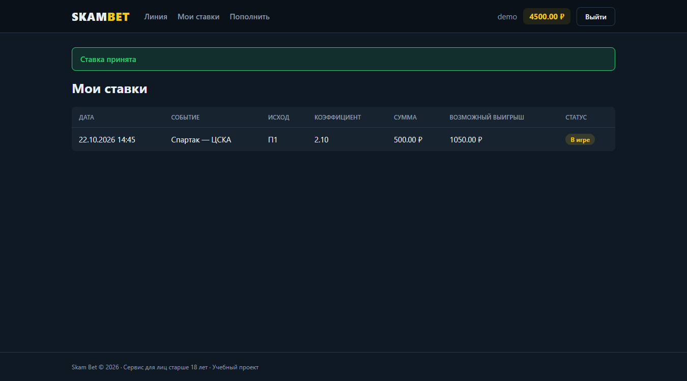
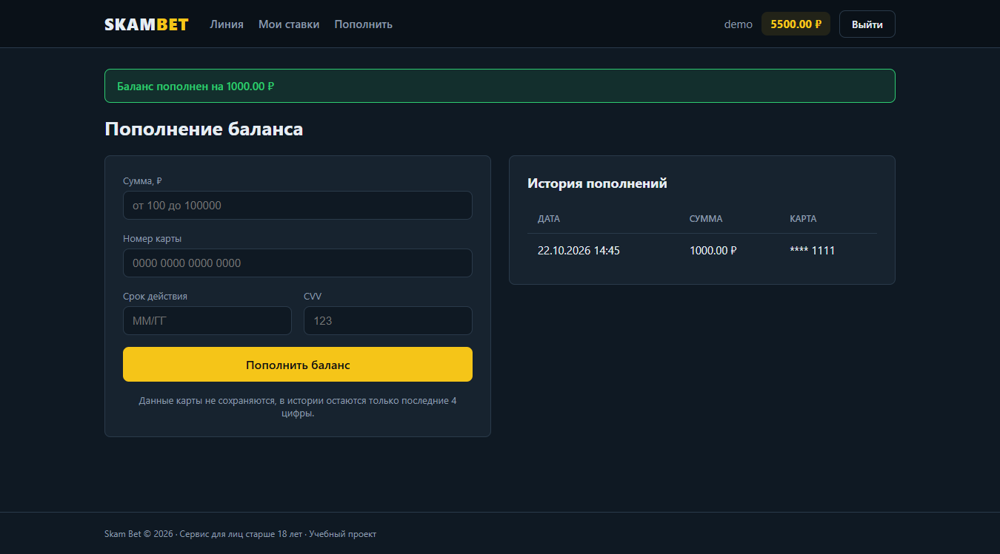

# Skam Bet


Веб-приложение букмекерской конторы (учебный проект) и UI-автотесты к нему на Cucumber + Selenium WebDriver.



## Возможности

| № | Функция | Что умеет |
|---|---|---|
| 1 | Регистрация | логин, email, дата рождения (только 18+), пароль, согласие с правилами |
| 2 | Авторизация | вход и выход, возврат на запрошенную страницу после входа |
| 3 | Линия событий | предстоящие матчи с коэффициентами П1 / X / П2, фильтр по виду спорта |
| 4 | Пополнение баланса | оплата картой, проверка номера по алгоритму Луна, история пополнений |
| 5 | Ставки | купон с расчётом выигрыша на лету, списание с баланса, раздел «Мои ставки» |

Документация:

- [docs/features.md](docs/features.md) — UI-фичи и их Gherkin-сценарии
- [docs/scenarios.md](docs/scenarios.md) — сценарии выполнения прецедентов

| Купон | Мои ставки | Пополнение |
|---|---|---|
|  |  |  |

## Стек

- Java 17, Gradle
- Spring Boot 3: Web, Security, Data JPA, Thymeleaf
- PostgreSQL 16, миграции Flyway
- Docker, Docker Compose
- Cucumber 7, Selenium WebDriver 4, JUnit 5, AssertJ, Testcontainers

## Запуск

### Всё в Docker

```bash
docker compose up --build
```

Приложение: http://localhost:8080, PostgreSQL доступна с хоста на порту `5433`.

### Локально

```bash
docker compose up -d db
./gradlew bootRun
```

Подключение к БД можно поменять переменными `DB_URL`, `DB_USER`, `DB_PASSWORD`.

При старте создаются демо-события и пользователь **demo / demo12345** с балансом 5000 ₽
(отключается переменной `DEMO_DATA=false`).

## Автотесты

Feature-файлы лежат в `src/test/resources/features`, шаги и page objects — в `src/test/java/ru/skambet/bdd`.

- Тесты сами поднимают приложение на случайном порту и отдельный PostgreSQL в Docker через Testcontainers.
  Docker должен быть запущен, база из `docker-compose.yml` не используется и не меняется.
- Перед каждым сценарием база очищается, нужные данные создаются шагами `Дано`.
- Драйвер браузера скачивается автоматически (Selenium Manager), нужен установленный Chrome или Edge.

```bash
./gradlew test
```

| Параметр | Описание |
|---|---|
| `-Dheadless=true` | без окна браузера |
| `-Dbrowser=edge` | Edge вместо Chrome |
| `-Dstep.delay=1500` | пауза после каждого шага в мс, чтобы было видно, что делает тест |
| `-Dcucumber.filter.tags=@bet` | одна фича: `@registration`, `@login`, `@events`, `@deposit`, `@bet` |

Например, посмотреть оформление ставки в замедленном режиме:

```bash
./gradlew test -Dcucumber.filter.tags=@bet -Dstep.delay=1500
```

Отчёты: `build/cucumber-reports/cucumber.html` (при падении к сценарию прикладывается скриншот)
и `build/reports/tests/test/index.html`.

## Структура

```
src/main/java/ru/skambet
    config/        безопасность, демо-данные
    domain/        сущности: User, Event, Bet, Deposit
    repository/    Spring Data репозитории
    service/       бизнес-логика
    web/           контроллеры и формы
src/main/resources
    db/migration/  миграции Flyway
    templates/     страницы Thymeleaf
src/test/java/ru/skambet/bdd
    pages/         page objects
    steps/         step definitions
    support/       браузер, хуки, тестовые данные, Testcontainers
src/test/resources/features   feature-файлы
docs/                         фичи и сценарии прецедентов
```
